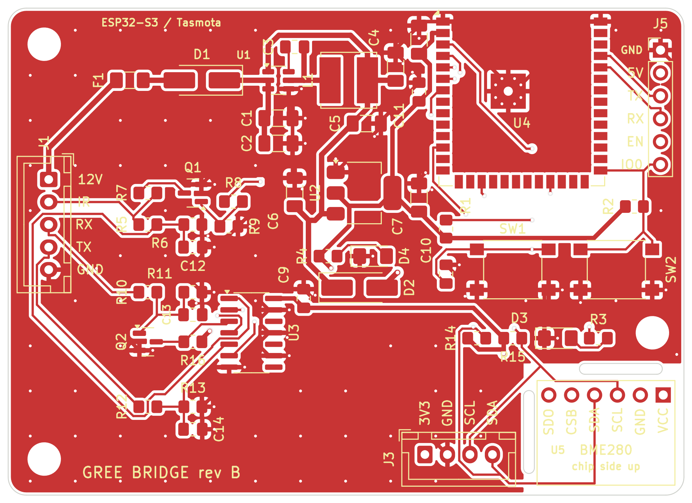
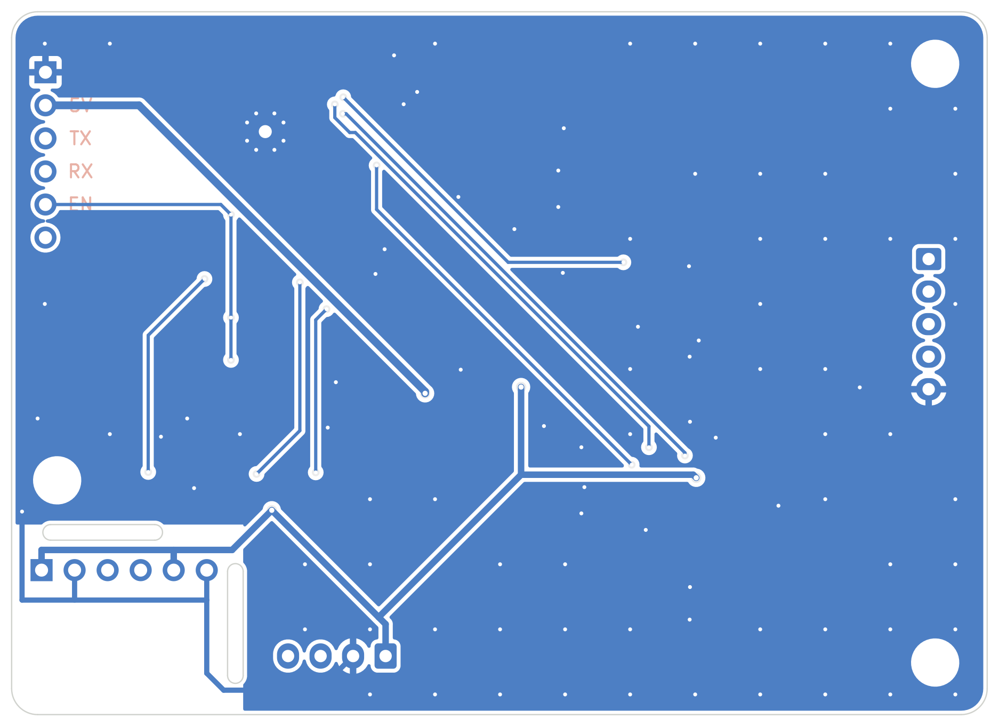
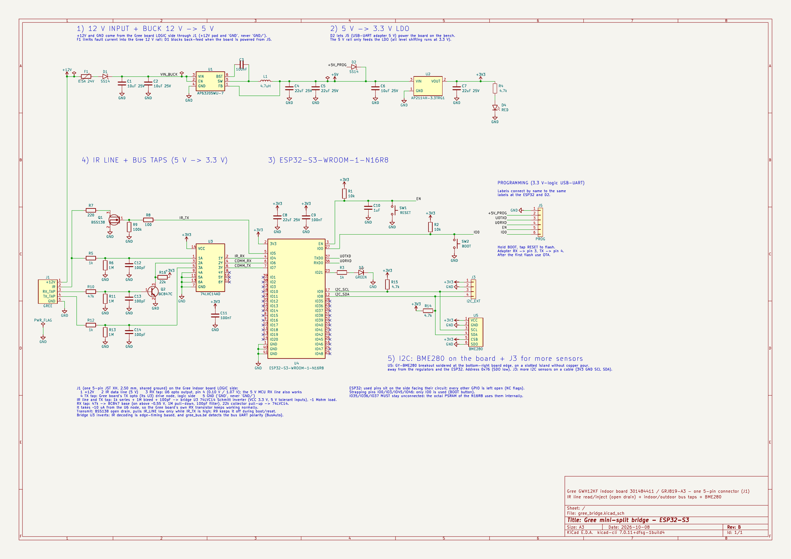
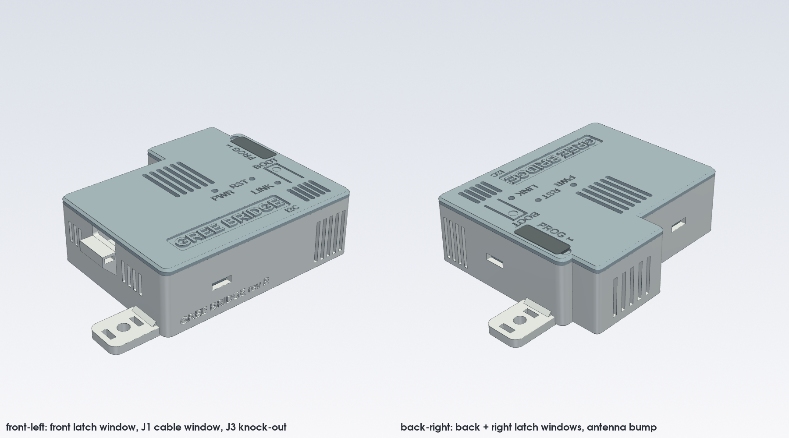

# Hardware: Gree bridge rev B

ESP32-S3 board that sits inside a Gree indoor unit. It reads and drives the unit's demodulated IR receiver line, listens to both sides of the indoor/outdoor bus through two high-impedance taps, and carries a BME280 breakout. It runs Tasmota.

Files: [`hardware/`](../hardware/). Interactive view of the board: [`board_viewer.html`](board_viewer.html) (open it in a browser after downloading).

| Top | Bottom |
|---|---|
|  |  |

## Board

| Item | Value |
|---|---|
| Size | 75 x 54 mm, 2 layers, 1.6 mm, 1 oz copper |
| Copper | GND pour on both layers (except the BME280 corner), about 90 stitching vias |
| Mounting | 3 x M3: H1 top left, H2 bottom left, H3 right above the BME280, with a track-free ring around each |
| Antenna | The ESP32-S3 module antenna overhangs the top edge by 6 mm (no copper under it). Leave room above that edge in a case |
| Tracks | 0.6 mm for 12 V / 5 V / switch node, 0.5 mm 3.3 V, 0.4 mm GND, 0.25 mm signals; vias 0.6/0.3 mm (0.8/0.4 mm on power) |
| Fab rules | JLCPCB 1-2 layer rules (via hole >= 0.3 mm, pad >= 0.5 mm, ring >= 0.13 mm, track/space >= 0.127 mm), stored in the project |
| DRC | Clean, 0 unconnected. Only an intentional footprint-mismatch warning on U4 (see Assembly notes) |

The KiCad files were made with KiCad 7 and open in KiCad 7, 8 and 9. Every symbol carries Manufacturer, MPN and Mouser fields.

## Connectors

### J1: to the Gree indoor board (JST XH 5-pin vertical, B5B-XH-A)

| Pin | Signal | Goes to on the Gree board (GRJ819-A3) |
|---|---|---|
| 1 | +12V | +12 V rail, logic side ("+12V" label on the back) |
| 2 | IR | IR receiver data line |
| 3 | RX tap | U6 (RX opto) output pin 4: top pin next to D16. About 0.10 V idle, 1.07 V during bits |
| 4 | TX tap | U3 (TX opto) LED drive node, logic side |
| 5 | GND | logic "GND" (not "GND/", that is the hot side) |

Cable: XHP-5 housing and SXH-001T-P0.6 crimps. Read [SAFETY.md](../SAFETY.md) before connecting anything.

Tap points on the Gree board: blue = RX tap (U6), green = TX tap (U3), red box = hot side, never touch (details in [protocol.md](protocol.md)).

### J3: I2C for more sensors (JST XH 4-pin)

1 +3V3 · 2 GND · 3 SCL (GPIO9) · 4 SDA (GPIO8). The BME280 on U5 is at 0x76, so a second sensor here must use 0x77.

### J5: programming (1x6 2.54 mm straight header)

1 GND · 2 +5 V in (through D2, powers the board on the bench) · 3 TX (U0TXD) · 4 RX (U0RXD) · 5 EN · 6 IO0. Pin 1 at the top, square pad, labelled on both sides. Use a 3.3 V USB-serial adapter: adapter TX to J5-4, RX to J5-3; EN to RTS and IO0 to DTR for automatic download mode. **Never connect anything to J5 while the board is inside a powered unit.**

## How the circuit works

- **Power:** J1-1 12 V → F1 (0.5 A resettable fuse) → D1 SS14 → U1 AP63205 buck (5 V, 1.1 MHz, L1 4.7 µH) → U2 AP2114H LDO (3.3 V). D3 status LED (GPIO21), D4 power LED.
- **IR receive:** IR line → R5 1k → C12 100 pF / R6 1M → U3 (74LVC14 at 3.3 V, 5 V tolerant inputs) → GPIO4. Load on the Gree line about 1 MΩ.
- **IR transmit:** GPIO5 → R8 → Q1 BSS138 (R9 100k gate pull-down) → R7 220 Ω → IR line. Pulls the line low only while GPIO5 is high; off during boot, reset or when unpowered, so the wall remote keeps working.
- **RX tap:** R10 47k → Q2 BC847C base (R11 1M, C13 100 pF) → collector, R16 22k to 3.3 V → U3 → GPIO6. Q2 turns on above about 0.55 V, between the two levels of the opto output, and draws about 10 µA from the Gree node. Q2 inverts like the Gree board's own transistor stage (the firmware's `BusAuto` finds the polarity anyway).
- **TX tap:** R12 1k → C14 100 pF / R13 1M → U3 → GPIO7 (full logic levels on this node).
- **I2C:** GPIO8 SDA / GPIO9 SCL, R14/R15 4.7k pull-ups, BME280 breakout (U5) and J3.

Full schematic: [`hardware/gree_bridge_revB_schematic.pdf`](../hardware/gree_bridge_revB_schematic.pdf).

### ESP32-S3 pins used

| GPIO | Use | Tasmota template |
|---|---|---|
| 0 | BOOT button (Button1) | 32 |
| 4 | IR receive | IRrecv 1088 |
| 5 | IR send (Q1) | IRsend 1056 |
| 6 | Bus RX tap | (Berry script) |
| 7 | Bus TX tap | (Berry script) |
| 8 / 9 | I2C SDA / SCL | 640 / 608 |
| 21 | Status LED | LedLink 544 |
| 43 / 44 | U0TXD / U0RXD (J5) | |

IO35-37 are left free (octal PSRAM on the N16R8 module); IO19/20 (USB) are not used.

## BME280 corner (U5)

- A **GY-BME280 6-pin breakout** (11.6 x 15.3 mm, 3.3 V version), plugged on a header, not a bare chip, so it can be replaced easily. It is not in the BOM.
- VCC and CSB to 3.3 V (I2C mode), SDO to GND: address **0x76**.
- Mounting: short header pins into the breakout, long pins through U5, soldered on the back and trimmed. Breakout flat, **chip side up**, body over the corner. Pin 1 (VCC, square pad) on the right.
- Thermal island: two 1.2 mm milled slots, no copper pour, joined to the rest only by the I2C and supply tracks. It still reads a little warm: compare with a thermometer after an hour and set `TempOffset` in Tasmota.
- Inside the unit it measures the unit's own air: room-like values while the unit is off, the conditioned air while it runs (up to 100 % humidity while cooling). That is why Home Assistant and Apple Home use the unit's own room sensor while it runs.
- BMP280 look-alikes have no humidity; the board works the same.

## Bill of materials

[`hardware/bom.csv`](../hardware/bom.csv): one line per part with the Mouser number (for hand assembly) and the LCSC number used by JLCPCB (for assembled boards). Prices in October 2026, parts only: about CAD 32 for one board from mouser.ca, about CAD 25 per board for 8. Assembled by JLCPCB, parts plus assembly came to about USD 18 per board for 10 boards (see [order-jlcpcb.md](order-jlcpcb.md)).

| Refs | Value | Part |
|---|---|---|
| C1 C2 C6 | 10 µF 25 V 1206 | YAGEO CC1206KKX7R8BB106 |
| C3 C9 C11 | 100 nF 0805 | YAGEO CC0805KRX7R9BB104 |
| C4 C5 C7 C8 | 22 µF 25 V 1206 | TDK C3216X5R1E226M160AB |
| C10 | 1 µF 0805 | YAGEO CC0805KKX7R8BB105 |
| C12 C13 C14 | 100 pF C0G 0805 | YAGEO CC0805JRNPO9BN101 |
| D1 D2 | SS14 SMA | SS14 |
| D3 | green LED 1206 | Lite-On LTST-C150KGKT |
| D4 | red LED 1206 | Lite-On LTST-C150KRKT |
| F1 | PTC 0.5 A 24 V 1206 | Bel Fuse 0ZCJ0050AF2E |
| J1 | JST XH 5-pin vertical | JST B5B-XH-A(LF)(SN) |
| J3 | JST XH 4-pin vertical | JST B4B-XH-A(LF)(SN) |
| J5 | 1x6 2.54 mm straight | Wurth 61300611121 |
| L1 | 4.7 µH shielded 6x6 | TDK VLS6045EX-4R7M (or Bourns SRN6045TA-4R7M) |
| Q1 | BSS138 SOT-23 | BSS138 |
| Q2 | BC847C SOT-23 | onsemi BC847CLT1G |
| R1 R2 | 10k 0805 | |
| R3 R5 R12 | 1k 0805 | |
| R4 R14 R15 | 4.7k 0805 | |
| R6 R11 R13 | 1M 0805 | |
| R7 | 220 Ω 0805 | |
| R8 | 100 Ω 0805 | |
| R9 | 100k 0805 | |
| R10 | 47k 0805 | |
| R16 | 22k 0805 | |
| SW1 SW2 | tact switch 6x6 SMD | C&K PTS645SL43SMTR92 LFS |
| U1 | buck 5 V 2 A TSOT-23-6 | Diodes AP63205WU-7 |
| U2 | LDO 3.3 V 1 A SOT-223 | Diodes AP2114H-3.3TRG1 |
| U3 | hex Schmitt inverter SOIC-14 | TI SN74LVC14ADR |
| U4 | ESP32-S3 module, 16 MB flash / 8 MB PSRAM | Espressif ESP32-S3-WROOM-1-N16R8 |
| U5 | BME280 breakout | GY-BME280, 6 pins, 3.3 V (not in the BOM) |

Also needed and not in the BOM: XH housings and crimps, a GY-BME280 breakout, a 3.3 V USB-serial adapter.

## Case

A 3D-printable case is in [`hardware/case/`](../hardware/case/): 80 x 69.6 x 25.3 mm, PETG without supports, closed with 3 x M3 x 20 screws through the board's mounting holes, with a cable window for J1, a cap over J5, a BOOT key, a RESET pin hole, LED light pipes, a baffle and vents around the BME280, and 5 mm of air around the antenna. Designed and fit-checked in CAD, not printed yet.

## Assembly notes (hand soldering)

- **ESP32 module centre pad:** it has a 1.0 mm plated hole open on the back. Solder the side pads first, then heat the hole from the back and feed solder until it flows through. Or use hot air.
- **Do not run "Update footprint from library" on U4:** the footprint has enlarged thermal vias and the solder hole.
- J1 and J3 plug in from the top (vertical through-hole). J5 is labelled on both sides.
- The [assembly sheet](../hardware/gree_bridge_revB_assembly_sheet.pdf) shows every part with its direction (cathodes and pin 1 marked in red) and has a checklist in soldering order.

## Bring-up

1. Power from J5 (5 V) only: check 5 V and 3.3 V. Flash Tasmota through J5 ([install.md](install.md), step 2). `I2CScan` lists 0x76.
2. In the unit, J1 with only pins 1, 2 and 5 at first if you like: press the wall remote, the console shows `IrReceived` with `"Protocol":"GREE"`; a command from the console makes the unit beep.
3. Add the bus taps (J1-3, J1-4): the main page shows the Gree rows. If neither polarity decodes, check a bit on a scope (1667 µs = 600 baud) and the Q2 collector (0 / 3.3 V).

Example readings from the first board, cooling: room 19.5 °C, indoor coil 13.6 °C, compressor 46 Hz, 1.9 A, about 480 W, outdoor air 7.9 °C.

## Revision history

- **Rev A:** two 3-pin connectors, RX input could not read the low-voltage opto node, wrong fuse voltage rating. Never built.
- **Rev B (current):** one 5-pin JST XH J1, Q2 stage for the RX tap, BME280 breakout on a thermal island, plain THT programming header, 24 V fuse. Built and working since October 2026.
