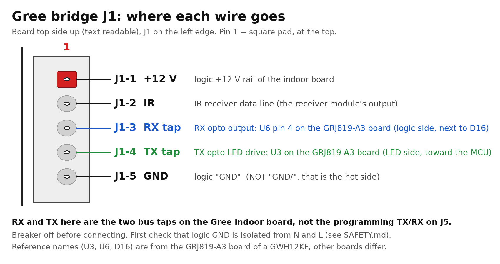
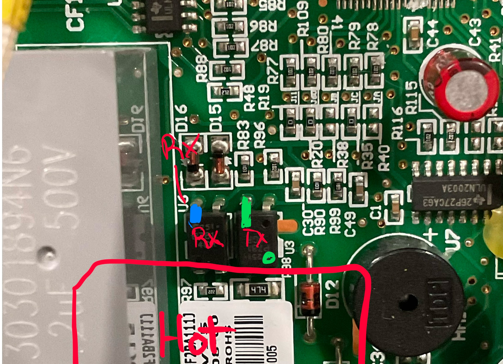

# Installing a board, from blank to working

How to take a Gree bridge rev B board from blank to working in a Gree indoor unit: flashing, settings, scripts, wiring, then **Home Assistant**, **Apple Home** (Matter, straight from the board), or both. Every room is done the same way; only the names change.

> ⚠️ Read **[SAFETY.md](../SAFETY.md)** first. Steps 1 to 5 are done on the bench, with the board powered from the USB-serial adapter only. Step 6 is the only one inside the unit, with the breaker off.

Hardware reference: [hardware.md](hardware.md). Bus decoding: [protocol.md](protocol.md).

## What you need

- A board with J1 (5-pin JST XH), J5 (1x6 2.54 mm header), the U5 header and, optionally, J3 soldered, and a **GY-BME280** breakout (3.3 V version) on U5, chip side up.
- A **3.3 V** USB-serial adapter, ideally with RTS and DTR pins (a CH340 adapter worked), and 6 jumper wires for J5.
- Chrome or Edge (the web flasher needs Web Serial), or `esptool.py`.
- From this repository:
  - [`firmware/build/gree_tasmota32s3_15.6.0.factory.bin`](../firmware/build/) (first flash),
  - [`firmware/tasmota/`](../firmware/tasmota/): `gree_bus.be`, `gree_matter.be`, `autoexec.be` (the same three files on every board),
  - [`homeassistant/`](../homeassistant/) (only with Home Assistant).
- A 5-wire cable with a JST XH 5-pin housing (XHP-5 and SXH-001T-P0.6 crimps) to the Gree indoor board.
- A name for each room, chosen **before** the board first connects to MQTT (Home Assistant builds the entity ids from it and keeps them):

| Room | DeviceName | Topic | Entity ids start with |
|---|---|---|---|
| Bedroom (example) | Bedroom heat pump | gree_bedroom | `bedroom_heat_pump` |
| Living room (example) | Living room heat pump | gree_living | `living_room_heat_pump` |

Topic: letters, digits, `_` and `-` only.

## 1. Check the board on the bench

- Diodes and LEDs the right way round: [assembly sheet](../hardware/gree_bridge_revB_assembly_sheet.pdf) (cathode marks in red). Boards assembled by JLCPCB were checked in their placement preview, but have a look anyway.
- Power it from the adapter only (5 V on J5-2): the red LED D4 lights. Nothing gets hot.

## 2. Flash Tasmota (once per board)

1. Wire the adapter to J5:

   | J5 pin | Board | Adapter |
   |---|---|---|
   | 1 | GND | GND |
   | 2 | 5 V in | 5 V |
   | 3 | U0TXD | RX |
   | 4 | U0RXD | TX |
   | 5 | EN | RTS |
   | 6 | IO0 | DTR |

   With RTS and DTR wired, the flasher puts the board in download mode by itself. Without them: hold BOOT, tap RESET, release BOOT, then connect.
2. In Chrome, open esptool-js: https://espressif.github.io/esptool-js/ . Default baud rate, **Connect**, pick the adapter's port.
3. On a board that had other firmware: **Erase Flash** first.
4. Program `gree_tasmota32s3_15.6.0.factory.bin` at address **0x0**. About a minute.

   Or from a terminal: `esptool.py --chip esp32s3 --port <port> write_flash 0x0 gree_tasmota32s3_15.6.0.factory.bin`
5. Disconnect in the flasher, press RESET (or power cycle).

If it fails: "Failed to open serial port" = another program holds the port (close it, or unplug and replug). "Failed to connect with the device" = TX and RX not crossed, no 5 V on J5-2, or the board did not enter download mode. Some cheap adapters never connect; another adapter may work at once.

## 3. Wi-Fi, names, password

1. On a phone or computer, join the Wi-Fi network `tasmota-xxxxxx-nnnn`; the setup page opens (or browse to `http://192.168.4.1`). Pick your home network (2.4 GHz) and its password, **Save**. The board restarts and joins it.
2. Find its IP address (your router's client list), open `http://<board ip>`.
3. **Tools → Console**, one line (the board restarts):
   ```
   Backlog DeviceName Bedroom heat pump; Topic gree_bedroom; Sleep 10; TelePeriod 60; WebPassword <a password>
   ```
   `WebPassword` protects the web page and the setup hotspot (user `admin`). Avoid `;` in it.
4. Time zone, for example Eastern time with daylight saving (see the Tasmota `Timezone` docs for others):
   ```
   Backlog Timezone 99; TimeDST 0,2,3,1,2,-240; TimeSTD 0,1,11,1,2,-300
   ```

## 4. GPIO template

In the console, one line (the board restarts):
```
Backlog Template {"NAME":"Gree Bridge S3","GPIO":[32,1,1,1,1088,1056,0,0,640,608,1,1,1,1,1,1,1,1,1,0,0,544,0,0,0,0,0,1,1,1,1,1,1,1,1,1,1,1],"FLAG":0,"BASE":1}; Module 0
```
GPIO0 = BOOT button, GPIO4 = IR in, GPIO5 = IR out, GPIO8/9 = I2C (BME280, J3), GPIO21 = status LED. GPIO6/7 (bus taps) are left to the script. Same template in [`firmware/tasmota/template.json`](../firmware/tasmota/template.json).

## 5. Scripts

1. **Tools → Manage File system**: upload `gree_bus.be`, `gree_matter.be` and `autoexec.be`.
2. Console: `BrRestart`.
3. Checks:
   - The main page shows the BME280 rows (temperature, humidity, dew point, pressure) and "Gree link: no valid frame yet" (normal on the bench).
   - `I2CScan` lists 0x76.

`gree_matter.be` does nothing until Matter is turned on (step 7b), so it can stay on boards that never use Apple Home.

## 6. Install in the indoor unit

**Breaker off** before opening the unit and before plugging or unplugging anything. Do the isolation check in [SAFETY.md](../SAFETY.md) first.



| J1 pin | Signal | Goes to on the Gree indoor board (GRJ819-A3) |
|---|---|---|
| 1 | +12 V | logic +12 V rail ("+12V" on the back) |
| 2 | IR | IR receiver data line |
| 3 | RX tap | U6 (RX opto) pin 4: top pin on the logic side, next to D16 |
| 4 | TX tap | U3 (TX opto) LED side, toward the MCU |
| 5 | GND | logic "GND" (**not** "GND/", that is the hot side) |

J1-3 and J1-4 are the two bus taps, not the programming TX/RX of J5. On another board, find the equivalent points first ([protocol.md](protocol.md), "Finding the tap points").



Where to solder the two bus taps on the GRJ819-A3 indoor board (component side, oriented as in the photo; the top row of pins of both optocouplers is the logic side):

- **Blue: RX tap** → J1-3. U6 (RX opto), top-left pin, next to D16.
- **Green: TX tap** → J1-4. U3 (TX opto), top-left pin.
- **Red box: hot side** (communication loop, about 56 V, mains nearby). The bottom pins of U3 and U6 are on the hot side: never solder, probe or route a wire there.

Take +12 V and GND from the logic side too (points labelled `+12V` and `GND` on the back of the board), never from `GND/`.

Breaker on, then check:
- The wall remote works as before, and the console shows `IrReceived` with `"Protocol":"GREE"` at each press.
- Within a few seconds of the unit running, the main page shows the Gree rows: room, coil, state, indoor fan, link OK, compressor, outdoor values.
- `BusAuto` shows the tap polarity. On the first board: RX inverted, TX normal (these are also the starting values). If a tap shows bytes but no frames, the script switches its polarity by itself within about 20 s and saves the one that works.
- `Weblog 3` shows the raw `BUS: RX ...` lines (set back with `Weblog 2`).

Fix the board so it cannot move (the [printed case](../hardware/case/), or standoffs on the M3 holes) and keep it and the cable away from the hot side and the fan.

## 7a. With Home Assistant

1. On the board: **Configuration → MQTT**: host = your MQTT broker (for example the Mosquitto add-on), port 1883, the MQTT user and password. Leave "Topic" as it is. Save.
2. In Home Assistant the board appears by itself (Settings → Devices & services → MQTT) with all the Gree sensors, plus the BME280 through the Tasmota integration.
3. Install the [`tasmota_irhvac`](https://github.com/hristo-atanasov/Tasmota-IRHVAC) custom integration (HACS), if not done yet.
4. Make the room's package (Linux or macOS shell, in the `homeassistant/` folder):
   ```
   ./new_room.sh "Bedroom heat pump" gree_bedroom
   ```
   It writes `packages/gree_bedroom.yaml`: the IR climate (`climate.bedroom_heat_pump`), a turbo switch, a display switch, the outdoor energy counter, and the **follow-the-unit automation** (keeps the climate in line with the unit's own on/off, mode and setpoint from the bus; never sends IR). Details in [`homeassistant/README.md`](../homeassistant/README.md).
5. Copy `packages/gree_bedroom.yaml` to `/config/packages/` (File editor or Samba add-on), and make sure `configuration.yaml` has:
   ```yaml
   homeassistant:
     packages: !include_dir_named packages
   ```
   Do **not** copy `gree_homekit.yaml` if the room uses Apple Home through Matter (7b), or the unit shows twice in Apple Home.
6. Developer tools → Check configuration, then Settings → System → Restart.
7. Dashboard: see [`homeassistant/dashboard_card_example.yaml`](../homeassistant/dashboard_card_example.yaml). Energy: Settings → Dashboards → Energy, add `sensor.bedroom_heat_pump_outdoor_energy`.

## 7b. Apple Home straight from the board (Matter)

Over your normal Wi-Fi; no Thread, no extra hardware. The iPhone, and the HomePod or Apple TV that acts as home hub, must be on the same network as the board (Matter finds it by mDNS and talks IPv6 link-local).

1. Console: `SetOption151 1`, then `Restart 1`.
2. Endpoints. Either in **Configuration → Matter**:
   - remove the BME280 temperature, pressure and humidity endpoints Tasmota adds by itself (inside the unit they read the unit's own air),
   - add a **v.HVAC** endpoint: Vendor `GREE`, Model -1, Min 16, Max 30, Fan Auto, Temp sensor `Gree#Room`, name "Bedroom heat pump",
   - add a **v.HVAC option** endpoint: HVAC endpoint 2, Option `Light`, name "Bedroom display".

   Or all at once from a terminal (the board restarts):
   ```
   curl -u admin:<WebPassword> http://<board ip>/matterc --data-urlencode 'config_json={"2":{"type":"v_hvac","name":"Bedroom heat pump","vendor":"GREE","model":-1,"min_temp":16,"max_temp":30,"fan":"Auto","temp_filter":"Gree#Room"},"3":{"type":"v_hvac_option","name":"Bedroom display","hvac_ep":2,"option":"Light"}}'
   ```
3. Pair: while the board is not paired, its main page shows **"Commissioning open"** with a QR code and a manual pairing code for about 10 minutes after a restart (Configuration → Matter → Open commissioning reopens it). In the Home app: **+ → Add Accessory**, scan the code (or "More options…" and type the code), accept the "uncertified accessory" warning, choose the room.
4. In the Home app you get a **thermostat** (Off, Heat, Cool, Auto, target temperature, room temperature) and a **display switch**.
   - Commands from the Home app are sent by the board as IR. They keep the fan speed and display state the unit had last (from Home Assistant or the wall remote) and always send swing Off.
   - The Home app shows the unit's real state from the bus, including changes made with the wall remote or Home Assistant (about 15 s after a change).
   - Room temperature: the unit's own sensor while it runs, the BME280 once the unit has been off for a while (it reads the room well then).
   - No fan speed control in the Home app for this device type; Dry and Fan only show as Cool or Off there.
5. With Home Assistant too: changes made in the Home app reach Home Assistant within about 15 s (follow-the-unit automation).

Free memory with Apple Home connected: about 130 KB of heap, which is fine.

## 8. Without Home Assistant

The board works on its own: the wall remote, the bus decoding, the web page and Apple Home do not need Home Assistant or MQTT.

1. Do steps 1 to 6, skip 7a, do 7b.
2. Turn MQTT off in the console: `SetOption3 0` (`SetOption3 1` turns it back on if Home Assistant comes later). The script's MQTT publishing then does nothing.

What works without Home Assistant:
- The Home app and Siri: on/off, mode, target temperature, room temperature, display on/off; Home app automations and scenes (schedules, "when I leave"); control away from home through the home hub.
- The wall remote as always, and the Home app follows it (bus).
- The board's web page shows everything the bus gives: room and coil temperatures, mode, setpoint, indoor fan, compressor Hz and current, estimated outdoor power, outdoor temperatures, link status.
- Manual IR commands from the console, for example: `IRhvac {"Vendor":"GREE","Power":"On","Mode":"Cool","Temp":22,"FanSpeed":"Auto","Light":"On"}`.
- Wi-Fi recovery (BOOT 6 times), firmware updates from the web page.

What you do not get without Home Assistant: energy history and graphs, the turbo switch, fan speed and swing control from the app, dashboards and notifications.

Other ecosystems: the board is a standard Matter thermostat, so Google Home, Amazon Alexa or SmartThings should also work (not tested). One board can be in two of them at once: in the Home app, the accessory's settings → "Turn On Pairing Mode" gives a new code for the second app.

## 9. Updates and upkeep

- **Firmware update**: Firmware Upgrade → Upgrade by file upload → `firmware/build/gree_tasmota32s3_15.6.0.bin` (the OTA file, not the factory one). Settings, scripts and the Apple Home pairing stay. Do not use the stock Tasmota OTA: it lacks the IR and sensor options this board needs.
- **Script update**: upload the new `.be` file in Manage File system, then `BrRestart`.
- **Backup** each board after setup: Tools → Backup Configuration; keep the file with the room name.
- **Wi-Fi changed or gone**: press BOOT 6 times quickly (inside the unit, breaker off to reach it, then on): the setup hotspot opens for 3 minutes. The board also opens it by itself when it cannot join its network. Do **not** hold BOOT 40 s: that resets all settings (Wi-Fi, MQTT, names, template, Matter on/off); the uploaded scripts stay, then redo steps 3, 4, 7a.1 and 7b.1.
- **Removing a board from Apple Home**: remove the accessory in the Home app first, then reset or reuse the board.

## 10. Troubleshooting

| Symptom | Check |
|---|---|
| Flasher can't open or connect | see step 2 |
| No Gree rows on the main page | unit powered and running; J1-3 / J1-4 wiring; `BusAuto`; `Weblog 3` |
| "Gree link: STANDBY" | normal: the indoor unit stops polling the outdoor unit some time after it is switched off |
| Remote presses not seen | J1-2 (IR line); the console should show `IrReceived` |
| Unit does not react to commands | J1-2; send `IRhvac` from the console; the unit beeps when it accepts a command |
| No entities in Home Assistant | MQTT settings; DeviceName and Topic set before MQTT; MQTT integration set up |
| Home app can't find the accessory | phone and hub on the same network as the board; commissioning window closed (restart or reopen); try the manual code |
| Home app or Home Assistant shows an old state | wait 15 s (both follow the bus after a change); bus link OK on the main page |
| BME280 shows 100 % humidity | the unit is cooling over it; normal inside the unit |
| BME280 reads a little warm | the board warms it slightly: compare with a thermometer after an hour and set `TempOffset` |
